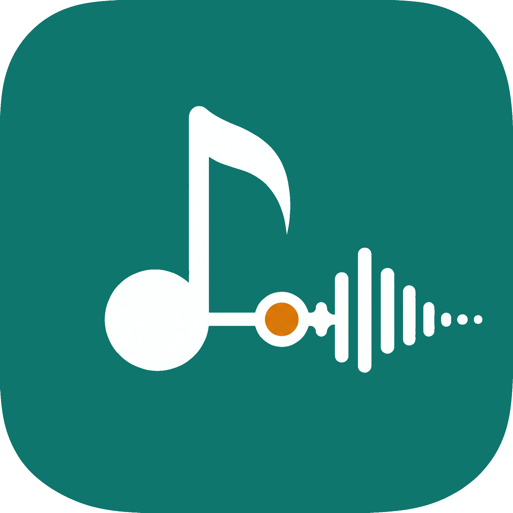

# AudioSeeker

<p align="center">
  
</p>

**AudioSeeker**는 기기에 저장된 오디오 파일을 빠르게 찾고, 현재 보고 있는 폴더나 검색 결과를 그대로 재생 큐로 사용할 수 있는 Android 로컬 오디오 플레이어입니다. 스트리밍, 계정, 클라우드 동기화 없이 기기 안의 파일과 재생 흐름에 집중합니다.

## 주요 기능

- **로컬 라이브러리** — MediaStore를 기반으로 기기의 오디오 파일을 스캔하고, 이름·크리에이터·폴더로 검색하거나 이름·추가 날짜·재생 시간으로 정렬합니다.
- **폴더와 자동 분류** — 기기 폴더를 탐색하고, 파일을 실제로 옮기지 않는 앱 내 자동 분류 폴더를 만들 수 있습니다.
- **현재 범위 재생** — 폴더나 검색 결과처럼 현재 보고 있는 목록을 재생 큐로 사용하며, 셔플과 한 번 재생·목록 반복·한 곡 반복을 지원합니다.
- **재생 제어** — 이전/다음 곡, 지정 간격 탐색, 파일별 이어 듣기, 0.5~2.0배 재생 속도를 제공합니다.
- **곡 전환과 타이머** — 필요할 때 파일 시작·끝의 연속 무음만 줄이고, 15분·30분·현재 곡 끝·사용자 지정 시간의 자동 끄기 타이머를 설정할 수 있습니다.
- **화면과 접근성** — 라이트·시스템·청록 다크·표준 다크 테마, 작은 창 높이 대응, 조작 잠금, 길게 눌러 보는 아이콘 도움말을 제공합니다.
- **Android 통합** — Media3 미디어 세션을 통해 백그라운드 재생과 시스템 미디어 제어를 지원하고, 앱 바로가기로 Samsung 모드 및 루틴의 재생 동작 진입점을 제공합니다.
- **안전한 삭제** — 앱 내부 확인 뒤 Android 시스템 권한 확인을 거쳐 실제 파일 삭제를 요청합니다.

## 지원 환경

| 항목 | 버전 |
| --- | --- |
| 최소 Android 버전 | Android 11 (API 30) |
| 대상 / 컴파일 SDK | API 35 |
| 언어 및 UI | Kotlin, Jetpack Compose, Material 3 |
| 재생 엔진 | AndroidX Media3 |
| Java | 17 |

오디오 라이브러리를 읽기 위해 실행 시 미디어 접근 권한이 필요합니다. Android 버전에 따라 알림 권한도 요청할 수 있습니다.

## 빌드하기

### 준비물

- Android Studio 또는 Android SDK와 Build Tools
- JDK 17
- Windows PowerShell 또는 명령 프롬프트

### 디버그 APK 만들기

```powershell
.\gradlew.bat assembleDebug
```

성공하면 APK는 다음 위치에 생성됩니다.

```text
app\build\outputs\apk\debug\app-debug.apk
```

## 프로젝트 구조

```text
app/
  src/main/java/com/creator/audioseeker/
    PlayerViewModel.kt     # 라이브러리·재생 상태의 단일 흐름
    PlaybackService.kt     # Media3 재생 및 미디어 세션 서비스
    ui/                    # Compose 화면, 구성 요소, 테마
  src/main/res/            # 문자열, 아이콘, 바로가기, 스타일
docs/                      # 구조·기술 사양·제품 계획·작업 기록
```

자세한 제품 요구사항은 [REQUIREMENTS.md](./REQUIREMENTS.md), 설계 및 기술 규약은 [docs](./docs/)에서 확인할 수 있습니다.

## 현재 검증 상태

아래 항목은 실제 기기에서 추가 회귀 검증이 필요합니다.

- 재생 서비스의 위치 저장과 복원
- 백그라운드 재생 중 자동 끄기 타이머
- 파일 형식별 곡 경계 무음 줄이기
- 제조사별 루틴 및 미디어 알림 노출

세부 작업 항목은 [TODO 목록](./docs/todo/00-todo-list.md)을 참고하세요.

## 범위

AudioSeeker는 오프라인 로컬 오디오 재생 앱입니다. 외부 스트리밍 서비스, 사용자 계정, 클라우드 동기화, 재생목록·즐겨찾기·A-B 반복은 현재 범위에 포함하지 않습니다.
